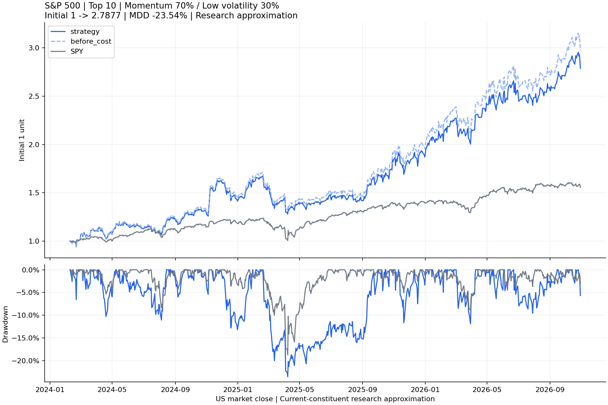

# FactorRoute周报：2026-11-02计划持仓周

报告日期：2026-11-01；信号与行情截止：2026-10-30美股收盘。计划执行日为 2026-11-02 开盘。状态为模拟研究候选，尚未真实执行，不报告账户实际收益。

## 本周更新了什么

本周完成并整理了“日线数据—原因子—综合评分—10只目标组合—按日估值—图表”的研究链路。

| 代码 | 本周增加的能力 |
|---|---|
| `factorcode/data/yfinance_source.py` | 下载快照、代码映射、有限重试、质量和交易日检查 |
| `factorcode/strategy/weekly.py` | 调用原RSTR/DASTD/HBETA，资格筛选、公司股类去重、评分及最终排名 |
| `factorcode/analysis/portfolio.py` | 下一交易日开盘差额调仓、按日收盘估值、成本和归一化绩效 |
| `factorcode/weekly_config.py`、`weekly_workflow.py` | 配置校验、阶段编排、有限权重研究、公开字段导出 |
| `scripts/run_weekly.py` | 唯一周度入口，不再为每周复制脚本 |
| `scripts/verify_weekly.py` | 无网络合成验证，检查资金、时间、排序及公开边界 |

原16类因子公式、原IC和Top−Bottom分析入口没有改变。新结果使用原RSTR动量、DASTD波动和HBETA代码；真实交易执行和完整公司行动账本仍未实现。

## 策略介绍

从获取时的标普500名单中，挑选历史走势较强、波动不过分拖累评分的公司。动量使用约一年收益的加权、滞后和平滑，并非最近几天涨幅；低波动是加分偏好，不代表每个入选股票都低于市场平均波动。BETA仅观察风险，不加入评分。

每周最后交易日收盘后，先要求三个因子齐全、当天有成交量、最近20日平均成交额代理至少1000万美元。同公司多股类按当时流动性保留一种，再缩尾、标准化并计算：

**综合分＝70%×动量标准分−30%×波动率标准分。**

取前10家公司，股票组合内部各10%；下一交易日开盘阶段计划按差额调仓，仅多头、不加杠杆。模拟按调整研究开盘价估算成交，不保证真实订单成交于Open。

## 为什么采用70/30

六组候选只按2024—2025训练期研究。纯动量训练夏普最高，但回撤约37.21%，且当前缩尾后有21只动量并列最高，代码顺序会影响纯动量前10名，不能将并列结果解释成明确的经济优势。

看到无风险限制结果后，我们确定了探索性风险筛选：训练历史最大回撤约25%以内，再比较训练夏普。满足条件者中70/30最高，因此选作本周固定模拟研究版。

| 动量/低波 | 训练夏普 | 训练累计收益 | 训练最大回撤 | 2026复核收益 | 2026复核回撤 |
|---|---:|---:|---:|---:|---:|
| 0/100 | 0.68 | +15.98% | −9.12% | +8.61% | −10.98% |
| 25/75 | 0.79 | +18.53% | −9.42% | +4.62% | −11.94% |
| 50/50 | 0.77 | +21.52% | −13.30% | +5.34% | −7.80% |
| **70/30** | **1.35** | **+86.96%** | **−23.54%** | **+49.11%** | **−11.90%** |
| 75/25 | 1.69 | +160.28% | −29.28% | +67.01% | −23.78% |
| 100/0 | 1.89 | +292.38% | −37.21% | +74.58% | −33.40% |

25%是历史筛选，不是止损承诺或未来损失上限。2026没有参与本轮权重排序，但此前已查看过部分2026结果，不能标为完全独立的样本外。下周固定规则后的记录才是新的前瞻观察。

## 本周候选与选择原因

| 排名 | 代码 | 公司 | 行业 | 股票内部目标权重 |
|---:|---|---|---|---:|
| 1 | PSX | Phillips 66 | 能源 | 10% |
| 2 | MPC | Marathon Petroleum | 能源 | 10% |
| 3 | VLO | Valero Energy | 能源 | 10% |
| 4 | RVTY | Revvity | 医疗 | 10% |
| 5 | NTAP | NetApp | 科技 | 10% |
| 6 | APA | APA Corporation | 能源 | 10% |
| 7 | CRL | Charles River Laboratories | 医疗 | 10% |
| 8 | TGT | Target | 必需消费 | 10% |
| 9 | EXPD | Expeditors International | 工业 | 10% |
| 10 | KEYS | Keysight Technologies | 科技 | 10% |

这些股票按同一综合评分入选，没有手工按行业故事挑股。PSX/MPC/VLO动量处于本期最高档；TGT/EXPD还获得较低波动加分；NTAP/CRL/KEYS波动并不特别低，但动量贡献足以进入前10。名单表示规则排序，不是下周上涨预测。

## 回测、验证及限制

同一固定快照的70/30策略，从2024-02-12开盘到2026-10-30收盘，初始归一化净值1约为2.7877，最大回撤约23.54%；同日起SPY约为1.5557。成本假设每单位实际买卖金额10bps，初始买入计费，终点按持有市值估值而不强制卖出。最大回撤按每日收盘观察，不包含盘中更深损失。



整理前后逐点比较了净值、最终名单及三原因子，结果一致；原合成研究链路继续通过。新增验证覆盖手续费资金守恒、未换仓不重复收费、初始本金回撤、持仓报价缺失停止、未来数据截断、评分权重改变名单、公司去重、跨目录CLI及公开导出白名单。安装可选依赖的新环境完成两只证券短区间下载验证，没有为整理重复下载全市场。

行情覆盖是当前名单，不是历史逐日名单，存在成分前视和幸存者偏差；后复权及修订历史不等于当时可得版本。分数股、全额成交、调整价总回报近似不包含精确现金分红、税、换汇、整数股、不可成交和订单核对，不能当作实盘业绩。

## 下周风险与计划

能源占股票目标仓位40%，没有行业上限。MPC、RVTY、EXPD在11月3日，CRL在11月4日，APA在11月5日有公司官方安排的财报相关活动，合计目标仓位50%，存在事件跳空集中。日期于本轮研究时核对，后续可能调整；其他股票未列出不代表无事件风险。

来源：[MPC](https://www.marathonpetroleum.com/Investors/Events-and-Presentations/)、[RVTY](https://ir.revvity.com/home/)、[APA](https://investor.apacorp.com/events-and-presentations)、[CRL](https://ir.criver.com/)、[EXPD](https://investor.expeditors.com/financial-information/upcoming-earnings)。未临时剔除财报股，因为该排除规则尚未验证。

下周模拟执行前检查最新报价、交易权限和数据状态，记录实际模拟成交与目标的差异；周内跟踪净值及行业/事件影响，周末按冻结规则更新。Top−Bottom与IC用于研究评分区分力，账户效果仍以多头持仓回测和前瞻记录为主。

## 如何复现

参数见[config.json](config.json)，结果见[selected.csv](selected.csv)及[metrics.json](metrics.json)。按根README安装后，在仓库根目录执行：

```bash
rtk proxy .venv-weekly/bin/python scripts/run_weekly.py --config experiments/weekly/2026-11-02/config.json --stage research
```

没有本地快照则改为`--stage all`；供应商重新下载会修订，数值不一定逐点相同。公开仓库不包含完整行情、账户金额、参考股数或下单预算。程序只研究，不下单。
