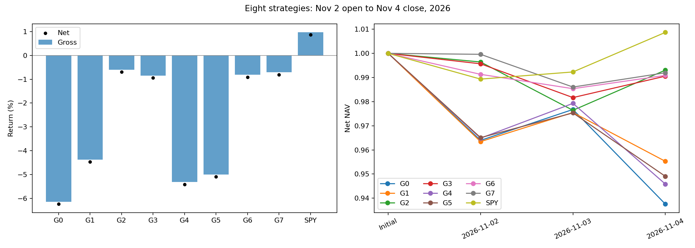

# 10月30日选股：8组对照研究

信号日2026-10-30，11月2日调整开盘买入，持有至11月4日调整收盘。各组买入后持有，股票内部等权，使用分数股。

这是看过行情后的三天诊断，不能确定三个月比赛的最优策略；未自动修改正式策略。

|组别|评分|只数|行业上限|毛收益|净收益|相对SPY毛收益差|比G0改善|净值收盘最大回撤|上涨数|
|---|---|---:|---|---:|---:|---:|---:|---:|---:|
|G0|原策略|10|无|-6.150%|-6.244%|-7.120个百分点|+0.000个百分点|-6.244%|1|
|G1|原策略|15|无|-4.377%|-4.473%|-5.346个百分点|+1.773个百分点|-4.473%|3|
|G2|新策略|10|无|-0.597%|-0.696%|-1.566个百分点|+5.553个百分点|-2.360%|6|
|G3|新策略|15|无|-0.846%|-0.945%|-1.815个百分点|+5.305个百分点|-1.832%|10|
|G4|原策略|10|30%|-5.320%|-5.415%|-6.289个百分点|+0.830个百分点|-5.415%|1|
|G5|原策略|15|30%|-4.999%|-5.094%|-5.968个百分点|+1.152个百分点|-5.094%|2|
|G6|新策略|10|30%|-0.814%|-0.913%|-1.783个百分点|+5.336个百分点|-1.464%|7|
|G7|新策略|15|30%|-0.705%|-0.804%|-1.674个百分点|+5.445个百分点|-1.396%|10|

SPY毛收益0.969%，同口径净收益0.868%。

本次毛收益最高的是G2（-0.597%），相对SPY落后1.566个百分点。这只说明这三天的结果，不能推断以后表现。

## 三项变化的配对比较

增加至15只：
- G1相对G0：改善1.773个百分点。
- G3相对G2：收益降低0.249个百分点。
- G5相对G4：改善0.321个百分点。
- G7相对G6：改善0.109个百分点。

改用新评分：
- G2相对G0：改善5.553个百分点。
- G3相对G1：改善3.531个百分点。
- G6相对G4：改善4.506个百分点。
- G7相对G5：改善4.294个百分点。

增加30%行业上限：
- G4相对G0：改善0.830个百分点。
- G5相对G1：收益降低0.622个百分点。
- G6相对G2：收益降低0.217个百分点。
- G7相对G3：改善0.141个百分点。

## G0名单与行业分配

PSX、MPC、VLO、RVTY、NTAP、APA、CRL、TGT、EXPD、KEYS

Consumer Staples 10.000%，收益贡献+0.514个百分点；Energy 40.000%，收益贡献-3.838个百分点；Health Care 20.000%，收益贡献-1.184个百分点；Industrials 10.000%，收益贡献-0.163个百分点；Information Technology 20.000%，收益贡献-1.480个百分点

## G1名单与行业分配

PSX、MPC、VLO、RVTY、NTAP、APA、CRL、TGT、EXPD、KEYS、PANW、VTRS、TRGP、HUM、CNC

Consumer Staples 6.667%，收益贡献+0.343个百分点；Energy 33.333%，收益贡献-3.142个百分点；Health Care 33.333%，收益贡献-0.120个百分点；Industrials 6.667%，收益贡献-0.108个百分点；Information Technology 20.000%，收益贡献-1.349个百分点

## G2名单与行业分配

HAS、ROP、TYL、ACN、IT、CCI、CRL、GDDY、RSG、COP

Consumer Discretionary 10.000%，收益贡献+0.183个百分点；Energy 10.000%，收益贡献-0.977个百分点；Health Care 10.000%，收益贡献-1.144个百分点；Industrials 10.000%，收益贡献+0.034个百分点；Information Technology 50.000%，收益贡献+0.776个百分点；Real Estate 10.000%，收益贡献+0.530个百分点

## G3名单与行业分配

HAS、ROP、TYL、ACN、IT、CCI、CRL、GDDY、RSG、COP、PTC、APA、LLY、MSI、VLTO

Consumer Discretionary 6.667%，收益贡献+0.122个百分点；Energy 13.333%，收益贡献-1.567个百分点；Health Care 13.333%，收益贡献-0.643个百分点；Industrials 13.333%，收益贡献+0.274个百分点；Information Technology 46.667%，收益贡献+0.615个百分点；Real Estate 6.667%，收益贡献+0.353个百分点

## G4名单与行业分配

PSX、MPC、VLO、RVTY、NTAP、CRL、TGT、EXPD、KEYS、PANW

Consumer Staples 10.000%，收益贡献+0.514个百分点；Energy 30.000%，收益贡献-2.464个百分点；Health Care 20.000%，收益贡献-1.184个百分点；Industrials 10.000%，收益贡献-0.163个百分点；Information Technology 30.000%，收益贡献-2.024个百分点

## G5名单与行业分配

PSX、MPC、VLO、RVTY、NTAP、APA、CRL、TGT、EXPD、KEYS、PANW、VTRS、HUM、FTNT、NUE

Consumer Staples 6.667%，收益贡献+0.343个百分点；Energy 26.667%，收益贡献-2.559个百分点；Health Care 26.667%，收益贡献-0.784个百分点；Industrials 6.667%，收益贡献-0.108个百分点；Information Technology 26.667%，收益贡献-1.668个百分点；Materials 6.667%，收益贡献-0.222个百分点

## G6名单与行业分配

HAS、ROP、TYL、ACN、CCI、CRL、RSG、COP、APA、LLY

Consumer Discretionary 10.000%，收益贡献+0.183个百分点；Energy 20.000%，收益贡献-2.351个百分点；Health Care 20.000%，收益贡献-0.965个百分点；Industrials 10.000%，收益贡献+0.034个百分点；Information Technology 30.000%，收益贡献+1.756个百分点；Real Estate 10.000%，收益贡献+0.530个百分点

## G7名单与行业分配

HAS、ROP、TYL、ACN、IT、CCI、CRL、RSG、COP、APA、LLY、VLTO、LMT、GILD、DIS

Communication Services 6.667%，收益贡献+0.428个百分点；Consumer Discretionary 6.667%，收益贡献+0.122个百分点；Energy 13.333%，收益贡献-1.567个百分点；Health Care 20.000%，收益贡献-0.462个百分点；Industrials 20.000%，收益贡献-0.127个百分点；Information Technology 26.667%，收益贡献+0.548个百分点；Real Estate 6.667%，收益贡献+0.353个百分点

## 口径与限制

原策略为70%原动量减30%波动标准分。新策略为40%相对同行的1个月动量、30%3个月绝对动量、减30%原波动标准分；同行为原资格池同GICS行业的其他公司。两个动量窗口重叠。行业上限只约束期初目标，不触发再平衡。

净收益统一假设从现金新建仓，买入费10bps，投入本金1/1.001，期末不卖出。收盘最大回撤包含初始本金1，仅代表三次收盘观察，不包含盘中回撤；不年化。逐股收益及组合贡献见运行目录stock_contributions.csv。

资格池沿用11月1日供应商快照和原资格过滤，公司名单不是严格逐日历史名单。选股输入截断于10月30日；估值行情在冻结名单后统一重新下载，供应商可能修订历史复权价格。G0与原名单、顺序、权重和评分已核对，约-6.15%毛收益仅作为先前复盘参考，差异不强行校准。

完整审计与来源：`outputs/weekly/2026-11-09/20261105-eight-way/freeze_manifest.json`、`download_manifest.json`、`evaluation_manifest.json`。

